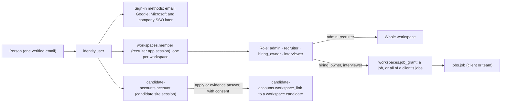

# ADR-009: Identity and account model

- **Status:** Accepted, 18 Nov 2026 (owner decision)
- **Ticket:** AIV-P0-905 (decision); built by AIV-P0-009, AIV-P0-010, AIV-P0-011, AIV-P0-906, AIV-P1-001, AIV-P1-002, AIV-P1-003, AIV-P1-055, AIV-P1-056, AIV-P1-057, AIV-P3-006, AIV-P3-013, AIV-P3-014, AIV-P5-013

## Context

ADR-001 planned two identity systems: a multi-tenant Microsoft Entra ID app for recruiters (company SSO) and Entra External ID for candidates. That shuts out the people Aivera now wants to serve first:

- **Individual recruiters** often have no company tenant, or use a personal email.
- **Freelancers** work for several agencies at once.
- **Agencies** recruit for several clients from one team, and a client's people must never see another client's jobs or candidates.
- **Candidates and recruiters** can be the same person, with the same email.

Two identity systems would also mean two sets of user flows, secrets and sign-in bugs for a small team. ADR-005 isolates workspaces from each other, but says nothing about access inside a workspace.

## Decision

### 1. One identity provider for everyone

- One **Microsoft Entra External ID** tenant holds recruiters, client users (hiring owners and interviewers from client companies) and candidates.
- Sign-in methods: **email with password** and **Google** (AIV-P0-009). A user flow offers one email method, password or one-time code, and the owner chose password. **Microsoft accounts** are not built-in providers in External ID: personal accounts come as a custom OIDC provider in AIV-P1-058, and work accounts as per-workspace company SSO in AIV-P1-057.
- **Company single sign-on** (any OIDC or SAML provider: Okta, Google Workspace, Entra ID) is added **per workspace, later**, as a federation in the same tenant (AIV-P1-057). It does not create a second identity system.
- This **replaces** the separate Entra ID multi-tenant app for recruiters.
- The free tier covers up to 50,000 monthly active users.
- The tenant has two app registrations, each with its own user flow: the **recruiter app** (recruiters and client users) and the **candidate site**.

### 2. Individual recruiters are first-class

- A solo recruiter signs up with any email, not only a work email. "Company" is optional.
- Sign-up creates a workspace with one member, its admin.
- Membership is per workspace. A person can belong to several workspaces (a freelancer working for two agencies) and switch between them. The active workspace is held server-side, and switching re-checks membership (AIV-P0-010, AIV-P1-055). It is kept per user, not per session (`workspaces.active_workspace`), because the session cookie holds only the user id: switching on one device switches the user's other sessions too. Creating a workspace makes it the creator's active workspace.

### 3. Agencies keep clients apart inside one workspace

- A workspace has a **type**: "In-house team" or "Agency".
- Agencies add **clients**. Each job belongs to a client, or to the team when it has no client.
- **Admins and recruiters** see the whole workspace.
- **Hiring owners and interviewers** see only the jobs they are assigned to: specific jobs, or all of one client's jobs. A client's people therefore never see another client's jobs or candidates. Enforcement is in [ADR-005](ADR-005-workspace-tenancy.md).
- Clients without accounts keep using **signed share links** (AIV-P2-013).
- The talent pool is **workspace-wide**. It is a recruiter tool, so hiring owners and interviewers have no pool access.

### 4. One login, kept apart

- **One account per verified email.** The `identity` module keeps one user per verified email. Each sign-in method (issuer and subject) maps to that user. An unverified email never joins an existing user.
- **What counts as verified** (amended 18 Nov 2026, owner decision on AIV-P0-009, PR #241).
  - An email is verified when the ID token says `email_verified: true`.
  - An email is also verified when the token comes from Aivera's own External ID tenant (issuer `https://<tenant-id>.ciamlogin.com/<tenant-id>/v2.0`) and carries no `email_verified` claim.
  - Reason: the tenant sends no `email_verified` claim (its metadata does not list one), yet it checks every email before it creates an account. Local accounts prove their email with a one-time code at sign-up, and Google-federated users arrive through the same issuer.
  - An explicit `email_verified: false` is always refused.
  - Any other issuer without `email_verified: true` is refused.
  - An unverified email never creates or joins a user.
- **Separate sessions.** The recruiter app and the candidate site have separate session cookies (`__Host-aivera-session`, `__Host-aivera-candidate`). Each middleware reads only its own cookie.
- **Separate data.** Recruiter-side data hangs off workspace memberships (`workspaces`). The candidate's own data hangs off the candidate account (`candidate-accounts`). Both point at the identity user id, and neither reads the other.
- **Nothing on the recruiter side reveals that a recruiter is also a candidate.** No recruiter-side module imports `candidate-accounts`, and `identity` offers recruiter code no "is a candidate" lookup.
- **A candidate's profile reaches a workspace only with consent**, when the candidate applies to that workspace's job or answers its evidence request. At that point `candidate-accounts` records a link (account → workspace, workspace candidate id, reason, consent). The workspace receives only what the candidate submitted. It never receives the account id or the rest of the profile.
- **Deletion requests propagate** to every workspace in the account's links, as `CandidateErasureRequested.v1` events carrying opaque ids (AIV-P3-014).

### 5. Recruiter pricing is decided later

- The billing unit is the **workspace**. A plan (solo, team, agency) attaches to one workspace and seats are its members, so adding a plan is a new column or table keyed on the workspace id, not a redesign.
- No plan column and no billing code are added now.
- The decision is AIV-P5-013.

### Model

## Consequences

- **Tickets that change:**
  - AIV-P0-009 drops the Entra ID provider and offers email with password and Google (Microsoft accounts: AIV-P1-058).
  - AIV-P0-011 uses the same tenant, with its own app registration, user flow and session.
  - AIV-P0-010 marks job-scoped actions. AIV-P0-906 adds workspace type, clients and job grants.
  - AIV-P1-001 accepts any email.
  - AIV-P1-003 invites people to jobs, not to the whole workspace.
- **Microsoft accounts.** AIV-P0-009 confirmed they are not built-in providers in External ID, and a user flow cannot offer them directly. Personal accounts become a custom OIDC provider (AIV-P1-058). Work accounts from any company cannot be one provider, because a custom provider needs one fixed issuer; they come as per-workspace company SSO (AIV-P1-057).
- **Cross-workspace reads.** Listing a person's workspaces for the switcher needs a named cross-workspace read keyed on the user (ADR-005, point 4).
- **Recruiter-side code never sees candidate accounts.** The architecture test gains a rule: no recruiter-side module imports `candidate-accounts` (AIV-P3-006).
- **A second isolation key.** Candidate-owned tables use row-level security on `app.candidate_account_id`, set by `withCandidateAccount` in `@aivera/db`, beside the workspace key `app.workspace_id` (AIV-P3-006).
- **Billing.** The free External ID tier removes identity cost for the pilot. Monthly active users are watched against the 50,000 limit before launch.
- **Google directly in the app (AIV-P0-928, 19 Nov 2026).** The dev tenant cannot create Google-federated users (AADSTS50132 after Google sign-in, reproduced from clean sessions, with and without `prompt=login`, on a fresh user flow and without the Display Name attribute), and it refuses `domain_hint` for one click. Recruiter "Continue with Google" therefore uses Auth.js's Google provider straight to Google; email with password stays on the tenant. Identity is unchanged: Google sends `email_verified=true`, so the user is still found by verified email and a recruiter who uses both methods is one user. The candidate side keeps the tenant until it needs Google.
- **Company SSO.** A workspace that federates its company SSO keeps its members' accounts: the user is still found by verified email.
